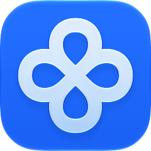

<p align="center">
  
</p>

<h1 align="center">Locus</h1>

<p align="center">
  <strong>English</strong> |
  <a href="README.zh-CN.md">简体中文</a>
</p>

<p align="center">
  <a href="https://github.com/oneo-me"></a>
  <a href="https://oneo.me"></a>
  <a href="https://x.com/oneo666"></a>
  <a href="https://github.com/sponsors/oneo-me"></a>
</p>

<p align="center">
  <a href="https://awesomemygo.dev/apps/locus"></a>
</p>

<p align="center">
  Locus is a local-first Markdown notebook for macOS, Windows, and Linux. Notes stay ordinary files in a folder you choose, so you can read and organize them in Locus while editing them in any app you like.
</p>

## Features

- Each note is a folder with an `index.md`; nested folders form the tree, and attachments sit beside the note.
- Read Markdown, local images, summaries and custom YAML properties in one window.
- Map the workspace's note hierarchy and links in a full-window relation graph.
- Give a note its own HTML and JavaScript page for dashboards, charts and other canvases.
- Let external Agents find notes through optional read-only MCP, and open your shell or Agent CLI in a built-in terminal.
- Use light and dark themes, five languages, back/forward history and remembered sidebar state.

## Install

Download the latest release from [GitHub Releases](https://github.com/oneo-me/locus/releases/latest).

- **macOS**: open the disk image and move `Locus.app` to Applications. macOS 13 or later, Apple Silicon or Intel.
- **Windows**: run the `Locus Setup` installer for your architecture. Windows 10 or later, with the WebView2 runtime, on x64 or ARM64.
- **Linux**: install the `.deb`, or unpack the tar.gz and run `locus`. GTK 3 and WebKitGTK are required, on x64 or ARM64.

A packaged app checks for updates once a day and shows them in Settings > About, where you can install and restart; development builds and the `.deb` package do not update themselves.

Releases are not yet signed or notarized. On first launch, allow Locus under System Settings > Privacy & Security > Open Anyway on macOS, or choose More info > Run anyway in Windows SmartScreen.

## Getting started

1. Launch Locus and choose **Open library** to select the folder for your notes. Initialize it as a Git repository so every change has history.
2. Open **Settings** with Command/Ctrl+, to choose your shell and Agent, and install the skills that teach Agents to work with Locus.
3. Enable MCP in Settings and add `http://127.0.0.1:2301/mcp` to your Agent; you can send it the address and ask it to configure itself. See [MCP access](docs/mcp.md).
4. Start writing: ask your Agent, or use any editor, to create a folder with an `index.md`. Locus follows file changes automatically.

Command/Ctrl+F searches notes and commands, Command/Ctrl+O switches libraries, and the sidebar's graph button shows how notes connect.

## Development

Build and test from `source/` with Go 1.27.1 or later:

```sh
cd source
GOWORK=off go test ./...
GOWORK=off go vet ./...
GOWORK=off go tool mygo dev
GOWORK=off go tool mygo build -platform darwin/arm64,darwin/amd64,windows/amd64,windows/arm64,linux/amd64,linux/arm64
```

See [Running and building](docs/build.md) for dependencies, checks and packaging, [Architecture](ARCHITECTURE.md) for design boundaries, and [AGENTS.md](AGENTS.md) for contributor rules. User-visible changes are listed in [CHANGELOG.md](CHANGELOG.md).

## License

[MIT](LICENSE) © 2026 ONEO.
