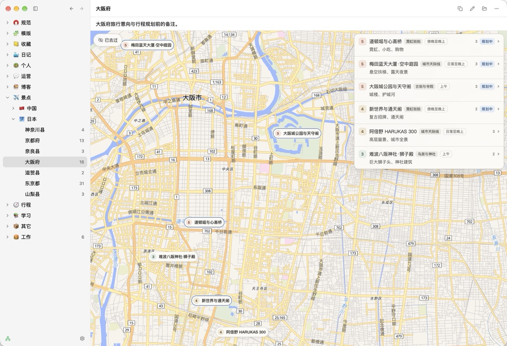

# Locus

[English](README.md) | **简体中文**

Locus 是本地优先的 Markdown 知识工作台，使用 Rust 和 GPUI 构建原生桌面界面，服务于长期维护个人知识的开发者、创作者和一人团队。用户可以阅读与组织笔记、查看文件变化、打开笔记画布和外部终端，并通过 MCP 让 Agent 发现和维护同一套本地文件。

Markdown 文档树始终是知识内容的唯一事实来源，用户可以直接访问、编辑和版本管理。外部 Agent 通过 MCP 接口定位文件，按 Locus skill 使用自身文件工具编辑；模型调用、账户、权限、远程数据策略与计费由对应客户端负责。



## 快速开始

macOS 用户可从 [GitHub Releases](https://github.com/oneo-me/locus/releases/latest) 下载 Apple Silicon / Intel 通用 ZIP，解压后将 `Locus.app` 移入「应用程序」。发布版通过 Sparkle 自动检查与下载更新，并由原生更新流程处理安装和重启。没有内置更新器的旧版用户，需要先手动安装一次首个支持更新的版本；源码构建不包含自动更新。默认发布版使用 ad-hoc 签名，未经 Apple 公证，首次打开可能被 macOS 拦截；确认信任该发布版本后，可在尝试打开应用后前往「系统设置 → 隐私与安全」允许打开。维护者配置见[手动发布说明](docs/build.md#manual-macos-releases)；推送 tag 不会触发自动发布。

「设置 → 关于」显示应用版本、许可证与项目链接，以及更新状态。macOS 应用菜单中的「关于 Locus」打开此页，「检查更新」则打开此页并开始 Sparkle 检查；页面内也提供相同的检查按钮和手动下载链接。

启动应用后，在设置中选择本地 Markdown 文档库。每篇笔记由目录中的 `index.md` 表达；应用会读取外部编辑器与 Agent 对真实文件的修改。

从源码运行需要 Rust 和平台构建工具，在项目根目录执行：

```sh
cd source
cargo run --locked -p oneo-tool-packer -- run
```

该命令构建并启动 macOS 的 `dist/Locus Dev.app`（Windows 为 `dist/Locus Dev/`），包含应用资源。开发版仍共享现有 Locus 设置与数据。详见[运行与构建](docs/build.md)。

macOS 需要 Xcode 与 Command Line Tools，最低系统版本为 macOS 13；Windows 需要 Visual Studio C++ 工具链与 Windows SDK。

## 笔记与画布

文档库是用户选择的本地根目录。目录层级组织笔记，每篇笔记的标题、图标、概要和归档状态来自 `index.md` 的 YAML frontmatter。`assets/` 存放附件，`assets/icon.png` 为笔记图标；`assets` 和 `canvas` 是保留目录，不作为子笔记。

通过侧栏或命令面板选择笔记，标题栏工具栏依次提供复制引用、编辑笔记、打开所在目录和更多菜单；更多菜单提供图标上传和归档，侧栏右键菜单保留这四项操作并绑定对应笔记。归档项在设置中恢复。外部文件变更会更新应用的派生视图，Git 状态提示正文、画布和附件的变化。

Markdown 支持连续文本选择、全选和复制。概要和自定义 YAML 在正文头部展示，对象与数组递归展开并保留顺序、空集合与 null。

有 `canvas/index.html` 与 `canvas/main.js` 的笔记运行 HTML/JavaScript 画布，模版调用方使用互斥的 `canvas/index.json`。原生画布当前支持 macOS，标题栏和头部以下显示网页，内置 Tailwind，通过系统 WebView 读取文件。画布笔记的 `index.md` 只保留 frontmatter；普通笔记显示 Markdown 正文。

保存画布后手动刷新或重新进入笔记生效，离开时释放网页临时状态。标题栏更多菜单中的“下载画布”导出已保存的入口、数据和引用资源；默认保存到系统下载目录，可在通用设置中修改。结果为单个 HTML 或带 `canvas.html` 和资源的目录，同名自动编号；动态资源需先加载，在线数据仍需网络，模块或 Worker 可能需要本地 HTTP 服务。编写规则见随软件发布的 skill [画布参考](source/resources/skills/locus/references/canvas.md)与[附件参考](source/resources/skills/locus/references/attachments.md)。

## 外部 Agent

在终端设置中选择系统终端或 Ghostty，并选择 Codex、pi、OpenCode 或 Claude Code，Unix 平台还可通过 Shell 选项选择默认、zsh、bash 或 fish（3.0 或以上），需要先安装所选 Shell；默认系统终端、Codex 与原有平台 Shell。需要先安装所选软件。Locus 在当前文档库根目录运行 `codex`、`pi`、`opencode` 或 `claude`；切换文档库、修改设置或退出 Locus 不结束已有外部会话。

macOS 系统终端使用 Terminal，每次创建新窗口；Ghostty 需要 1.3.0 或以上，优先在最近使用的窗口中新建标签页，没有窗口时创建窗口。默认使用 zsh；选择 bash 或 fish 后加载对应 Shell 的登录与交互配置，Agent 退出或找不到命令时保留所选 Shell。Windows 使用系统控制台。

| 操作 | macOS 快捷键 |
| --- | --- |
| 命令面板 | Command+E |
| 设置 | Command+, |
| 打开 Agent | Command 与反引号 |
| 刷新当前笔记或聚焦的画布 | Command+R 或 F5 |
| 关闭窗口 | Command+W |

其他平台使用对应的 Control 组合键。MCP 在设置中启用，默认关闭、端口为 `2301`；只提供 `/mcp` 只读发现。使用方法放在随应用发布的 skills 中，在「技能」设置中选择笔记库或全局 `.agents/skills` 后自动安装，切换位置时移除旧的 Locus 链接。局域网模式没有身份验证，客户端可以搜索笔记内容并获取本机路径。

源码位于 `source/`，最终应用产物位于 `dist/`。

采用 [MIT 开源协议](LICENSE)。
